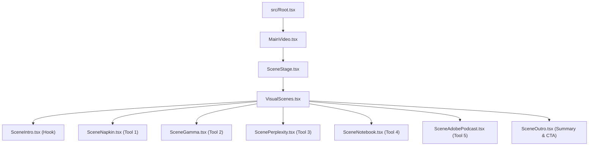

# Remotion Vertical Video Component Architecture

This document describes the modular component architecture for the 9:16 vertical video.

---

## 1. Composition Settings

The video uses standard vertical dimensions for Instagram Reels, YouTube Shorts, and TikTok.

| Parameter | Value | Description |
| :--- | :--- | :--- |
| **Canvas Width** | `1080px` | Horizontal canvas size |
| **Canvas Height** | `1920px` | Vertical canvas size |
| **Aspect Ratio** | `9:16` | Standard mobile vertical format |
| **Frame Rate** | `30 fps` | Smooth standard playback speed |
| **Primary Entry** | `current-video` | Root composition in `src/Root.tsx` |

---

## 2. Safe Zones and Layout Boundaries

Layout boundaries follow `src/shared/video-layout.json` and `src/shared/SceneStage.tsx`.

```
+------------------------------------------------------+  Y = 0
|                   Top Margin                         |
+------------------------------------------------------+  Y = 100
|   Caption Area (y: 100-260, h: 160, w: 1016)         |
+------------------------------------------------------+  Y = 260
|                   Buffer Zone                        |
+------------------------------------------------------+  Y = 320
|                                                      |
|   Action Stage (y: 320-1700, h: 1380, w: 896)        |
|   Left: 64px, Right: 120px                           |
|                                                      |
|   - All illustrations stay inside this area          |
|   - SceneStage component centers content here        |
|                                                      |
+------------------------------------------------------+  Y = 1700
|   Bottom Social UI Safe Margin (h: 220px)            |
|   (Clear of handles, captions, and sound icons)      |
+------------------------------------------------------+  Y = 1920
```

### Stage Coordinates
- **Action Stage Width**: `896px` (`1080 - 64 - 120`)
- **Action Stage Height**: `1380px` (`1700 - 320`)
- **Action Stage Origin**: `X = 64px`, `Y = 320px`
- **Caption Zone**: `Top = 100px`, `Height = 160px`, `Left = 32px`, `Right = 32px`

---

## 3. Modular Scene Architecture

The video separates each topic into an independent component.
All components live in `src/video/scenes/`.



### Scene Breakdown

#### 1. `SceneIntro.tsx` (Hook: 5 Secret Free AI Tools)
- **Role**: High-energy opening hook.
- **Visuals**:
  - Glowing red alert badge: `⚡ SECRET FREE AI ARSENAL`.
  - Number emblem: `05` with animated dashed border.
  - Bold headline: `5 SECRET FREE AI TOOLS`.
  - Preview bento grid showing cards for all five tools.
  - Dynamic scan beam sweeping across the bento cards.

#### 2. `SceneNapkin.tsx` (Tool 1: Napkin AI)
- **Role**: Show text converting to diagrams.
- **Visuals**:
  - Header badge: `TOOL 01 / 05 • TEXT TO DIAGRAM`.
  - Input card: Raw notes and text bullet points.
  - Transform pill: `⚡ 1-CLICK MAGIC` with directional pulse.
  - Output card: Three connected vector flowchart nodes (`TEXT` → `AI LOGIC` → `VECTOR`).
  - Export pills: `[SVG]`, `[PNG]`, `[PDF]`.

#### 3. `SceneGamma.tsx` (Tool 2: Gamma App)
- **Role**: Show one prompt generating complete presentation decks.
- **Visuals**:
  - Header badge: `TOOL 02 / 05 • AI PRESENTATIONS`.
  - Interactive prompt bar with a blinking cursor.
  - Multi-slide deck preview floating in 3D perspective.
  - Slide metrics card showing `+380%` speed increase.
  - Growing vertical bar charts for quarterly adoption.

#### 4. `ScenePerplexity.tsx` (Tool 3: Perplexity AI)
- **Role**: Show real-time web search with source citations.
- **Visuals**:
  - Header badge: `TOOL 03 / 05 • SEARCH & RESEARCH`.
  - Active search bar with `LIVE WEB` indicator.
  - Three source citation pills (`arXiv`, `GitHub`, `MIT Tech Review`).
  - Synthesized answer box with numbered reference badges (`[1]`, `[2]`, `[3]`).
  - Green verification badge for 100% cited facts.

#### 5. `SceneNotebook.tsx` (Tool 4: Google NotebookLM)
- **Role**: Show PDF documents converting to a two-host AI podcast.
- **Visuals**:
  - Header badge: `TOOL 04 / 05 • PDF TO PODCAST`.
  - Uploaded document cards (`80-Page_Paper.pdf`, `Annual_Report.csv`).
  - Two animated AI host avatars (`Host A` and `Host B`) with speaking rings.
  - 28-band dynamic audio frequency visualizer.
  - Interactive media scrubber bar with timestamp indicators.

#### 6. `SceneAdobePodcast.tsx` (Tool 5: Adobe Podcast AI)
- **Role**: Show phone microphone audio turning into studio sound.
- **Visuals**:
  - Header badge: `TOOL 05 / 05 • STUDIO AUDIO CLEANUP`.
  - Top card: Raw phone audio with a red noisy waveform and noise warnings.
  - Center toggle: `ENHANCE SPEECH` button switching from off to on.
  - Bottom card: Pristine green studio waveform at 48kHz broadcast quality.

#### 7. `SceneOutro.tsx` (Summary and CTA)
- **Role**: Summarize all tools and prompt user action.
- **Visuals**:
  - Header: `QUICK SUMMARY • ৫টি এআই টুল`.
  - Numbered list recapping all five tools with distinct brand colors.
  - High-conversion save reminder box with a glowing bookmark icon.
  - Follow prompt and social handle tag `@AI.INSIDER.PRO`.

---

## 4. Component Properties Interface

Every scene accepts standard properties defined in `src/video/scenes/types.ts`:

```typescript
export interface SceneProps {
  /** Scene index in the sequence */
  index?: number;
  /** Start frame in the global timeline */
  start?: number;
  /** Duration of the scene in frames */
  duration: number;
  /** Scoped visual events */
  events?: VisualEvent[];
  /** Video layout configuration */
  layout?: VideoLayout;
  /** Optional title override */
  title?: string;
  /** Optional subtitle override */
  subtitle?: string;
  /** Optional accent color */
  accentColor?: string;
}
```

---

## 5. Animation Rules and Verification

All animations follow strict Remotion deterministic rules:
- **No CSS transitions or keyframes**: Motion uses `useCurrentFrame()`.
- **No `Math.random` or timers**: Motion is purely frame-driven.
- **Easing**: Functions use cubic and quadratic polynomials (`easeOutCubic`, `easeInOutCubic`).
- **Remotion Studio Support**: Each scene has an isolated preview composition in `src/Root.tsx`.
